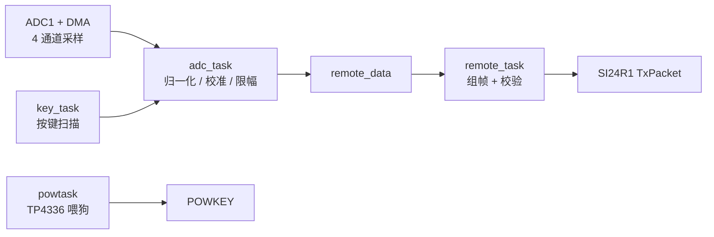

# STM32 无线遥控器（STM32F103C8T6 + SI24R1 + FreeRTOS）

基于 **STM32F103C8T6** 的 2.4 GHz 航模遥控器固件。4 通道摇杆经 ADC + DMA 采集，按键提供配平微调与零偏校准，数据按固定 17 字节帧通过 **SI24R1**（nRF24L01 兼容）发送；同时集成 TP4336 电源管理，防止遥控器在松手后掉电。


## 功能特性

- 4 通道摇杆采集（油门 / 偏航 / 俯仰 / 横滚），ADC 扫描 + DMA 循环搬运，全程无阻塞
- 原始 12 bit ADC 值归一化到 `0 ~ 1000`，支持零偏校准（长按校准键）与按键微调
- 6 个按键：四向微调、关机请求、定高切换、长按摇杆校准
- SI24R1 定频点、定地址收发，带帧头 + 累加和校验
- FreeRTOS 多任务调度：电源管理、无线发送、按键扫描、摇杆采集
- 时钟自适应：优先使用 8 MHz 外部晶振（72 MHz 主频），晶振失效时自动降级到内部 HSI（64 MHz）
- 启动阶段通过 USART1 裸寄存器打印引导日志，便于排查板级问题

## 硬件平台

| 项目 | 说明 |
| --- | --- |
| MCU | STM32F103C8T6（LQFP48，64 KB Flash / 20 KB SRAM） |
| 射频 | SI24R1 2.4 GHz 模块（SPI 接口，软件 NSS） |
| 摇杆 | 4 通道模拟摇杆（电位器，0 ~ 3.3 V） |
| 按键 | 6 个轻触按键，内部上拉，低电平有效 |
| 电源 | TP4336 移动电源管理芯片，通过 POWKEY 引脚保持输出 |
| 调试 | USART1，115200 8N1 |

## 引脚分配

| 引脚 | 功能 | 说明 |
| --- | --- | --- |
| PA1 | ADC1_IN1 | 摇杆 油门（thr） |
| PA2 | ADC1_IN2 | 摇杆 俯仰（pitch） |
| PA3 | ADC1_IN3 | 摇杆 横滚（roll） |
| PA6 | ADC1_IN6 | 摇杆 偏航（yaw） |
| PB3 | SPI1_SCK | SI24R1 时钟（SPI1 重映射） |
| PB4 | SPI1_MISO | SI24R1 数据输入 |
| PB5 | SPI1_MOSI | SI24R1 数据输出 |
| PA15 | GPIO 输出 | SI24R1 片选 CS（软件 NSS） |
| PB7 | GPIO 输出 | SI24R1 使能 CE |
| PA9 / PA10 | USART1_TX / RX | 调试串口 |
| PB2 | GPIO 输入 | 按键 `left_x`（关机请求） |
| PB10 | GPIO 输入 | 按键 `right_x`（定高 / 长按校准） |
| PB11 | GPIO 输入 | 按键 `up`（俯仰向前微调） |
| PB12 | GPIO 输入 | 按键 `right`（横滚向右微调） |
| PB13 | GPIO 输入 | 按键 `left`（横滚向左微调） |
| PB14 | GPIO 输入 | 按键 `down`（俯仰向后微调） |
| PB15 | GPIO 输出 | POWKEY，驱动 TP4336 维持供电 |

> 调试口仅保留 SWD（`__HAL_AFIO_REMAP_SWJ_NOJTAG()`），JTAG 已关闭，因此 PA15 / PB3 / PB4 可正常用作 CS / SPI1 重映射引脚。用 ST-Link 时请连接 SWDIO / SWCLK。

## 软件架构

工程由 STM32CubeMX 生成底层初始化代码（`Core/`），应用层代码位于 `MDK-ARM/appliaction`、`MDK-ARM/interface` 与 `freertos/`。



### FreeRTOS 任务

`configTICK_RATE_HZ = 1000`，`configMAX_PRIORITIES = 5`（数值越大优先级越高），`configTOTAL_HEAP_SIZE = 12 KB`。

| 任务 | 优先级 | 栈（字） | 周期 | 职责 |
| --- | --- | --- | --- | --- |
| `powtask` | 4 | 128 | 3000 ticks | 周期性拉低 / 拉高 POWKEY，维持 TP4336 供电 |
| `remote_task` | 3 | 384 | 6 ms | 组装遥测帧并通过 SI24R1 发送 |
| `key_task` | 2 | 256 | 20 ms | 扫描按键，更新微调量与指令位 |
| `adc_task` | 2 | 128 | 20 ms | 读取 DMA 缓冲区，换算并更新 `remote_data` |

### 目录结构

```text
.
├── Core/                  # CubeMX 生成的 HAL 初始化与中断
│   ├── Inc/
│   └── Src/
├── Drivers/               # CMSIS + STM32F1xx HAL
├── freertos/              # FreeRTOS 内核（含 GCC 移植层 poarable/）
├── commet/                # 串口日志封装（debug_printf）
├── MDK-ARM/
│   ├── appliaction/       # 应用层：任务、数据处理、组帧发送
│   ├── interface/         # 外设驱动：SI24R1 / 按键 / 摇杆 / TP4336
│   └── remote.uvprojx     # Keil MDK 工程
├── cmake/                 # 交叉编译工具链与 CubeMX 子工程
├── CMakeLists.txt
├── CMakePresets.json
└── remote.ioc             # STM32CubeMX 工程文件
```

## 通信协议

每帧固定 **17 字节**（`TX_PLOAD_WIDTH`），多字节数据为大端（高字节在前）。

| 偏移 | 长度 | 字段 | 说明 |
| --- | --- | --- | --- |
| 0 | 1 | HEAD0 | 固定 `0x77`（`'w'`） |
| 1 | 1 | HEAD1 | 固定 `0x7A`（`'z'`） |
| 2 | 1 | HEAD2 | 固定 `0x79`（`'y'`） |
| 3 | 2 | thr | 油门，`int16`，0 ~ 1000 |
| 5 | 2 | yaw | 偏航，`int16`，0 ~ 1000 |
| 7 | 2 | pitch | 俯仰，`int16`，0 ~ 1000 |
| 9 | 2 | roll | 横滚，`int16`，0 ~ 1000 |
| 11 | 1 | off_or_on | 关机请求标志，`1` = 请求关机，发送后自动清零 |
| 12 | 1 | height | 定高切换标志，`1` = 切换，发送后自动清零 |
| 13 | 4 | checksum | 第 0 ~ 12 字节累加和，`uint32` 大端 |

射频参数：信道 `40`，速率 2 Mbps，地址 `0x0A 0x01 0x07 0x0E 0x01`，自动应答 + 10 次重发（间隔 250 µs），16 位 CRC。发送时切换为 TX 模式，发送结束立即切回 RX 模式。

接收端建议先校验三字节帧头，再校验累加和，两者均通过后才更新通道数据。

## 数据处理

1. **采集**：`HAL_ADC_Start_DMA()` 循环填充 `adc_value[4]`，顺序为 `thr, yaw, pitch, roll`。
2. **归一化**：`value = 1000 - raw * 1000 / 4095`，将 12 bit ADC 映射到 `0 ~ 1000` 并统一极性。
3. **零偏补偿**：减去 `thr/yaw/pitch/roll_offset`（长按校准键时，采样 10 次取平均得到）。
4. **微调叠加**：俯仰 / 横滚叠加 `key_pitch_offset`、`key_roll_offset`（每次按键 ±10）。
5. **限幅**：`limit(value, 0, 1000)`，保证输出范围合法。
6. **发送**：`app_transmit_data()` 组帧 → `SI24R1_TxPacket()` 轮询等待 `TX_DS` / `MAX_RT`。

## 按键功能

| 按键 | 动作 | 效果 |
| --- | --- | --- |
| `up` / `down` | 短按 | 俯仰微调 ±10 |
| `left` / `right` | 短按 | 横滚微调 ±10 |
| `left_x` | 短按 | 置位关机请求，随下一帧发送 |
| `right_x` | 短按 | 置位定高切换标志 |
| `right_x` | 长按（> 1 s） | 执行摇杆零偏校准 |

按键采用"消抖 + 等待释放"的方式扫描，长按时间以 FreeRTOS tick 计数判定。

## 启动流程与时钟

1. `HAL_Init()` 后立即用裸寄存器初始化 USART1，输出 `[BOOT]` 日志（不依赖 HAL 状态机）。
2. `HSE_Probe()` 检测 8 MHz 外部晶振：成功则 PLL ×9 → **72 MHz**；失败则以 HSI/2 × 16 → **64 MHz**。
3. 时钟切换后重算 USART1 波特率，打印实际 `SYSCLK` / `PCLK2`。
4. 依次初始化 GPIO → DMA → USART1 → SPI1 → ADC1，校验 USART1 配置并关闭 `stdout` 缓冲。
5. 初始化 SI24R1，创建 4 个任务并启动调度器。若调度器意外返回，串口提示堆空间不足并复位。

> 注意：ADC 时钟固定为 PCLK2/6，两个时钟方案下分频系数一致，因此采样时序无需区分处理。

## 编译

### 方式一：CMake + Ninja + arm-none-eabi-gcc（VS Code / CLI）

依赖：`CMake >= 3.22`、`Ninja`、`arm-none-eabi-gcc`（建议 10.3 及以上）。

```bash
cmake --preset Debug
cmake --build --preset Debug
```

产物为 `build/Debug/flight.elf`（工程名沿用 `flight`，与 `remote.ioc` 中的工程名不同属正常现象）。
如需 Intel HEX，可手动转换：

```bash
arm-none-eabi-objcopy -O ihex build/Debug/flight.elf build/Debug/flight.hex
```

VS Code 中也可使用 CMake Tools 扩展的 `Build` 按钮，以及 [.vscode/launch.json](.vscode/launch.json) 里已配置好的 ST-Link 调试项。

### 方式二：Keil MDK

打开 [MDK-ARM/remote.uvprojx](MDK-ARM/remote.uvprojx)，选择 `remote` 目标后编译、下载即可。
工程已将 FreeRTOS 与应用层源码一并纳入，无需额外配置。

## 烧录与调试

- **ST-Link + OpenOCD**：直接使用 VS Code 的 `cortex-debug` 配置（`interface/stlink.cfg` + `target/stm32f1x.cfg`），下载后运行至 `main`。
- **Keil**：`Options for Target → Debug` 选择 ST-Link Debugger，勾选 `Reset and Run`。
- **串口日志**：USART1 @ 115200，可看到启动阶段信息、帧发送结果与按键事件：

```text
[BOOT] stage1: HAL_Init done, raw USART1 ready
[BOOT] HSE(8MHz) ready
[BOOT] stage2: clock ok, SYSCLK=0x044AA200 PCLK2=0x044AA200
[BOOT] stage3: peripheral init done
[UART] USART1 init OK, BRR=0x00000271 CR1=0x0000200C
hello remote
si24r1 init success cfg=0x0F ch=40 rf=0x06
[BOOT] stage4: SI24R1 init done, start FreeRTOS
si24 tx ok status=0x20
tx=0 off_or_on=0
```

（以上为 HSE 72 MHz、115200 波特率下的示例输出，具体数值随板子而异。）

`[BOOT]` / `[UART]` 前缀的日志走裸寄存器输出，不受日志开关影响；其余通过 `debug_printf` 输出。把 `commet/comment.h` 中的 `DEBUG_LOG_ENABLE` 置 0 可关闭 `printf` 日志，避免串口阻塞影响发送周期。

## 已知限制 / 待办

- 无线链路为单向发送，暂未处理接收端回传（ACK payload 未启用）。
- `SI24R1_TxPacket()` 采用轮询等待，超时依赖 `MAX_RT`；后续可改为中断 / EXTI 方式降低占用。
- 摇杆为线性映射，未加入死区与 expo 曲线。
- 未实现低电压检测与失控保护，关机仅依赖 TP4336 与按键请求。
- `FreeRTOSConfig.h` 中 `configCPU_CLOCK_HZ` 固定为 72 MHz。若走 HSI 64 MHz 降级路径，SysTick 实际节拍约 1.125 ms，任务周期会偏慢约 11%，此时需同步修改该宏。

## 许可证

- `Drivers/` 内的 CMSIS 与 STM32F1xx HAL 驱动遵循 STMicroelectronics 的原始许可，详见各子目录下的 `LICENSE.txt`。
- `freertos/` 为 FreeRTOS Kernel V10.5.1，遵循 MIT 许可。
- 其余应用代码（`Core/` 中的用户段、`MDK-ARM/appliaction`、`MDK-ARM/interface`、`commet/`）可自行选择开源许可证。
